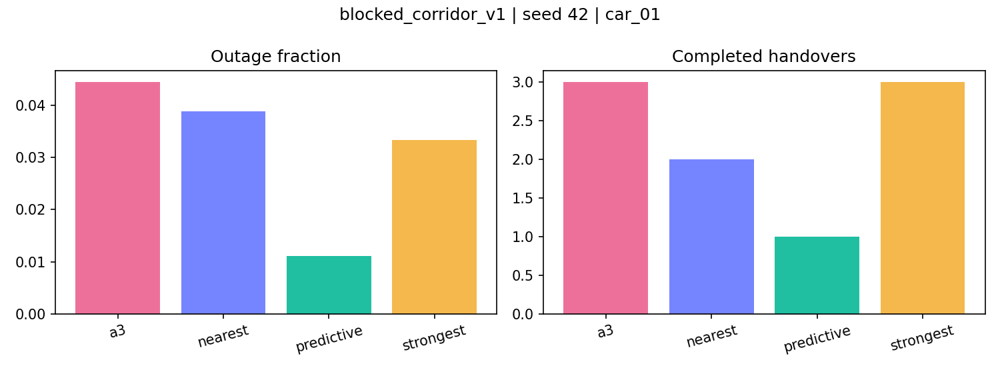
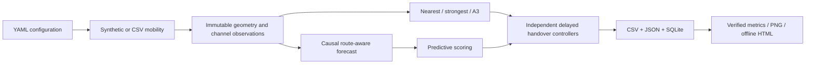

# HandoverAI · Proactive 5G Tower Selection

**A reproducible simulator for studying when a moving connected vehicle should change its serving tower.**

Owner and maintainer: **Shriram Masalekar** · Python 3.11+ · MIT license · Version 1.0.0

HandoverAI compares four tower-selection policies in the **same recorded world**. It predicts
short-term route geometry, estimates upcoming link obstruction, and trades connectivity against
handover cost. This repository completes the **self-contained Python Tier A** in the supplied
project blueprint, with additional CSV mobility replay, SQLite storage, sensitivity experiments,
and an offline interactive research console.

> All radio values are **synthetic power proxies**. This is a research/portfolio simulator, not
> an operational 5G modem, a standards-compliant NR implementation, or real vehicle control.
> SUMO/TraCI and ns-3/5G-LENA execution are optional extensions and are **not implemented** here.



## 1. What this project does

A car can have a strong current connection just before a building blocks its line to a tower.
Selecting only the strongest signal reacts after that change. Switching too often also causes
interruptions and unstable A → B → A behavior. HandoverAI makes these competing effects visible.

1. Load a versioned YAML road, route, towers, blockers and model settings.
2. Generate vehicle positions, or replay canonical CSV positions.
3. Compute distance, geometric line of sight and a seeded received-power proxy for every link.
4. Replay exactly these observations through nearest, strongest-current, A3-style and predictive policies.
5. Execute each policy's decisions through independent dwell/delay/failure state machines.
6. Save traces, handover events, metrics, configuration hashes and runtime metadata.
7. Store the run in SQLite and create scientific PNG figures plus an offline HTML dashboard.
8. Run matched-seed studies and ablations to see where proactive selection helps or hurts.

The research question is whether causal geometry-aware prediction reduces outage without
excessive switching. Results can support or refute the hypotheses; they are never hard-coded.

## 2. Run on a Mac — exact commands

Python 3.11 or newer is required. The release was tested with Python 3.14.7 and 3.12.14 on macOS ARM64.
The initial dependency installation needs internet access; subsequent simulations work offline.
If Python is missing, install a current Python from [python.org](https://www.python.org/downloads/macos/).
No paid API, API key, database server, Node.js or external dataset is required.

### Option A: prepared Desktop folder

Open **Terminal** and run:

```sh
cd ~/Desktop/HandoverAI-Proactive-5G
sh scripts/bootstrap.sh
source .venv/bin/activate
python -m handoverai --version
python -m pytest -q
sh scripts/demo.sh
```

The demo writes a unique run/report directory and opens the dashboard automatically on macOS.
To inspect the included report immediately, no installation is needed:

```sh
cd ~/Desktop/HandoverAI-Proactive-5G
open reports/demo/index.html
```

If the Desktop environment is already installed, just activate it and run the demo. Virtual
environments cannot safely be moved between folders or machines; rerun bootstrap after moving.

### Option B: fresh clone or extracted submission

```sh
cd /path/to/HandoverAI-Proactive-5G
python3 --version
python3 -m venv .venv
source .venv/bin/activate
python -m pip install -r requirements.lock
python -m pip install --no-deps --no-build-isolation -e .
python -m handoverai validate --config configs/blocked_corridor.yaml
python -m handoverai simulate --config configs/blocked_corridor.yaml --policy all
python -m handoverai report --runs runs/blocked_corridor_v1 --output reports/my-first-report
open reports/my-first-report/index.html
```

`handoverai ...` is also installed as a console command. Use `python -m handoverai ...` to make
interpreter selection explicit. Every simulation batch gets a unique directory; report and
benchmark outputs intentionally require a **new** destination to avoid silent overwrites.

To select a specific Python installed on your Mac:

```sh
PYTHON_BIN=python3.13 sh scripts/bootstrap.sh
```

### Run and debug in VS Code

1. Open **VS Code → File → Open Folder** and select `HandoverAI-Proactive-5G`.
2. Install the recommended Python and Python Debugger extensions if prompted.
3. Open **Terminal → New Terminal**, then run the bootstrap/activation commands above.
4. Use **Python: Select Interpreter** from the Command Palette and choose `.venv/bin/python`.
5. Open **Run and Debug**, select **HandoverAI: simulate all policies**, and press F5.
6. Place breakpoints in `src/handoverai/engine.py`, `policies.py` or `proactive.py` to inspect decisions.
7. Use the Testing panel for pytest, or **Terminal → Run Task** for tests, lint or the demo.

If the `code` command is installed, `code .` opens the current folder. The included `.vscode`
files configure the interpreter, test discovery, debug arguments and tasks. Run commands from
this project root so relative scenario/data paths resolve correctly.

## 3. Commands and scenarios

```sh
# Validate without running
python -m handoverai validate --config configs/blocked_corridor.yaml

# Compare all policies; SQLite is created automatically
python -m handoverai simulate --config configs/blocked_corridor.yaml --output runs/my-demo

# One policy with explicit overrides; no source edits
python -m handoverai simulate --config configs/dynamic_blocker.yaml --policy predictive \
  --set seed=7 --set predictive.horizon_s=3.0 --set channel.shadowing_std_db=2.0

# A portable report from persisted traces
python -m handoverai report --runs runs/my-demo --output reports/my-demo
open reports/my-demo/index.html

# List database runs (read-only)
python -m handoverai db --database runs/my-demo/results.sqlite3

# Export synthetic mobility; output must not already exist
python -m handoverai export-trace --config configs/blocked_corridor.yaml \
  --output /tmp/handoverai-mobility.csv

# Full research matrix, 30 matched seeds
python -m handoverai benchmark --config configs/blocked_corridor.yaml \
  --set channel.shadowing_std_db=2.0 --seeds 30 --suite full \
  --output reports/my-research

# Fast exploratory benchmark
python -m handoverai benchmark --seeds 3 --suite quick --output reports/my-quick-study

# All available flags
python -m handoverai --help
python -m handoverai simulate --help
```

| Scenario | Purpose | Seed/noise defaults |
|---|---|---|
| `blocked_corridor.yaml` | Blueprint's 850 m route, three towers and two rectangles | 42 / no shadow noise |
| `no_blockage.yaml` | Same route/towers without rectangles | 42 / no shadow noise |
| `dynamic_blocker.yaml` | A temporary parked bus appears at 35 s and leaves at 55 s | 42 / 2 dB noise |

All distances are meters, speed is m/s, time seconds and heading radians. There are 180
observations for a 90-second run at dt=0.5: times are `[0, 90)`, without an extra endpoint.
Unknown settings, invalid shapes, duplicate IDs, nonfinite values and incompatible tick grids
fail with actionable errors. Fewer or zero towers are allowed for edge-case studies; the supplied
scenarios each have three. See [configuration validation](src/handoverai/config.py).

## 4. How it is built



The core uses small Python modules and frozen data classes. All policies receive identical
position and link observations. Keyed random draws are independent of policy execution order.
A controller, rather than the policy, enforces switching delay and dwell constraints.

| Policy | Decision rule | Stability behavior |
|---|---|---|
| nearest | Choose shortest geometric distance | Common dwell/delay; unusable candidates rejected |
| strongest | Choose maximum current power proxy | Common dwell/delay |
| a3 | Neighbor exceeds serving proxy by a configured margin | Consecutive elapsed TTT, reset on lost advantage |
| predictive | Maximize mean forecast quality minus outage and switching penalties | Current feasibility, score margin, TTT and dwell |

The predictive algorithm projects the **current observed position** onto the planned route,
advances with **current measured speed**, and evaluates future geometry for a configurable
horizon. It receives currently visible rectangles with their future schedules removed. They
persist in the forecast. It never receives actual future noise or mobility observations.

```text
synthetic_rx_dbm = tx_power + gains - pl0 - 10*n*log10(max(distance,d0)/d0)
                   - blockage_penalty + seeded_shadowing

score[j] = weight_quality * normalized(mean(clamped_forecast_quality[j]))
           - weight_outage * forecast_outage_fraction[j]
           - weight_switch * (j != serving)
```

Rectangle edges/corners count as blocked; multiple blockers apply one fixed penalty. Future
shadowing is predicted as zero. No trained neural network is hidden behind the project name:
this is analytical, geometry-aware look-ahead. Read the [full architecture](docs/ARCHITECTURE.md)
for timer boundaries, route projection, recovery and failure semantics.

Initial/recovery attachment uses the same strongest-usable rule for every policy and is counted
separately. A switch can succeed only after its delay and if the target remains usable. During
switching the vehicle is in outage. A failed target keeps the old usable association or becomes
disconnected. Unfinished requests do not become imaginary successful handovers.

## 5. Real results included in this release

These numbers were generated by the actual runner. They describe this **synthetic corridor**,
not field-measured 5G performance. The packaged reports include raw downloadable traces.

| Policy | Default seed 42 outage | Completed handovers | 30-seed mean outage, 2 dB shadowing |
|---|---:|---:|---:|
| nearest | 3.89% | 2 | 3.33% |
| strongest | 3.33% | 3 | 4.70% |
| a3 | 4.44% | 3 | 3.52% |
| predictive | 1.11% | 1 | 3.26% |

For the noisy E1 study, predictive minus strongest mean outage is **−1.44 percentage points**;
its paired bootstrap 95% interval is **[−2.39, −0.48] percentage points**, using 30 paired seeds
42–71. Relative to strongest's mean outage, that is a **30.71% reduction in this experiment**.
There are 33 variants, 3,960 policy/variant/seed rows and 3,000 unique simulated inputs/policies.

Prediction is not universally better. At a 10 dB blockage penalty its mean outage is **0.37
percentage points higher** than strongest, with an interval spanning zero. Removing dwell
alone had no observable effect in this corridor. All tested predictive E6 ablations had zero
ping-pong returns, so they do **not** establish a ping-pong reduction; removing switching cost
increased mean handovers from 0.63 to 2.30. These negative/null outcomes are included.


See [measured findings](docs/RESULTS.md), [research protocol](docs/EXPERIMENTS.md), and the actual
[per-seed results](reports/research/results.csv), [paired intervals](reports/research/paired.csv)
and [configuration snapshots](reports/research/configs.json). The interactive report at
`reports/demo/index.html` opens directly from disk; no web server is needed. On GitHub, download
or clone before opening the HTML report locally.

## 6. Outputs and database

```text
runs/<scenario>/<unique-batch>/<policy>/
  config.yaml          # exact validated input
  manifest.json        # UUID, seed, config SHA256, code revision, runtime versions
  timeseries.csv       # position, serving/pending cell, power proxy, outage, state
  links.csv            # every current tower observation
  handovers.csv        # attachments, losses, attempts, success/fail/reject/incomplete
  metrics.json         # exact denominators and event counts
runs/results.sqlite3   # default normalized local database
reports/<report>/
  index.html           # offline interactive console; select a scenario/policy/seed
  summary.csv          # long-form metrics with units, backend and run IDs
  data.json            # report input data
  data/<run-id>/       # downloadable original run files
  figures/             # map, timeline, proxy quality, comparison
```

Outage fraction counts unusable or interrupted observations divided by observed vehicle-ticks.
Outage seconds are steps × dt. Quality means include only usable attached samples and record
the sample count. Ping-pong is a consecutive completed A → B → A inside the configured window.
For multiple vehicles, outage seconds are vehicle-seconds; episodes are kept separate per car.
All definitions are in [ASSUMPTIONS.md](docs/ASSUMPTIONS.md).

SQLite tables are `runs`, `observations`, `links`, and `events`, linked by UUID with foreign keys.
Writes are transactional; duplicate run IDs fail. The archive includes a generated example at
`data/demo.sqlite3`; large databases and arbitrary runs are ignored by Git. See
[DATABASE.md](docs/DATABASE.md) for schema details and inspection commands.

## 7. Dataset and CSV replay

The included [synthetic mobility dataset](data/corridor_mobility.csv) has 180 canonical
observations. Its [dataset card](data/DATASET_CARD.md) explains origin, license, units,
generation and limitations. No external/private dataset, personal telemetry or model download
is required. It is an evaluation fixture, not training data.

```sh
python -m handoverai simulate --config configs/blocked_corridor.yaml \
  --set simulation.mobility_backend=trace \
  --set simulation.trace_file=data/corridor_mobility.csv --output runs/replay
```

External mobility must use exactly
`time_s,vehicle_id,x_m,y_m,speed_mps,heading_rad`, sorted by time then ID, on the configured tick
grid. Each vehicle begins at zero and has a contiguous prefix; permanent departure is allowed.
This interchange can receive independently exported simulator positions, but is not a verified
SUMO/TraCI or online ns-3 co-simulation integration.

## 8. Tests, reproducibility and project layout

```sh
python -m pytest -q
python -m ruff check .
python -m ruff format --check src tests scripts
python -m pip check
python -m build --no-isolation
```

The 100 tests cover T01–T23, including malformed scenarios, geometry tangencies, zero distance, TTT
across tick sizes, delayed/failing switches, causal forecasts, exact replay, reversed policy
order, metrics denominators, trace gaps, database integrity, report tampering and CLI errors.
See [TESTING_REPORT.md](docs/TESTING_REPORT.md) for actual execution evidence, not a remote CI claim.
GitHub Actions is configured for Python 3.11 and 3.14 on Linux.

```text
configs/               three complete scenario YAMLs
src/handoverai/         typed config, geometry, mobility, channel, policies, engine,
                       metrics, SQLite/CSV storage, experiments and reporting
src/handoverai/dashboard.html   standalone offline report template
tests/                 unit, scenario, regression and end-to-end tests
data/                  synthetic mobility and its dataset card
reports/demo/          actual three-scenario report and raw run evidence
reports/research/      full 30-seed sensitivity/ablation study
scripts/               bootstrap, demo, benchmark and submission packaging
.vscode/               interpreter, tasks and launch configurations
.github/workflows/     automated lint/tests/smoke report
requirements.lock      exact direct/transitive tested dependency pins
docs/                  architecture, assumptions, requirements, experiments,
                       results, database, testing and limitations
```

The [requirements matrix](docs/REQUIREMENTS.md) maps every mandatory blueprint item to code and
verification. Manifests record source revision/config hash; timestamps and run UUIDs change on
repetition, while output traces/metrics remain deterministic on the tested runtime.

## 9. Submission and uploading to your GitHub

The final local repository contains **30 meaningful commits** under the configured owner identity.
The portable ZIP includes source, documentation, reports, dataset, example database and Git
history. It excludes virtual environments, caches, credentials and large scratch runs. Bootstrap
installs the same pinned dependencies on a new machine. See [SUBMISSION.md](docs/SUBMISSION.md).

Create a new **empty** GitHub repository named `HandoverAI-Proactive-5G` in your own account.
Then replace `YOUR_GITHUB_USERNAME` below and run from this project folder:

```sh
# Check the packaged history and working tree first

git status
git log --oneline
git rev-list --count HEAD

# Add your empty repository; do this only once

git remote add origin https://github.com/YOUR_GITHUB_USERNAME/HandoverAI-Proactive-5G.git
git push -u origin main
```

Authenticate using your own GitHub credential manager or SSH configuration. No credentials
belong in the project. If `origin` already exists, inspect it with `git remote -v` and use
`git remote set-url origin ...` if necessary. Uploading through GitHub's browser file picker
uploads files but does not preserve the local 30-commit history; use Git push for that.
Nothing has been published to your account automatically.

Suggested About text: “Reproducible blockage-aware handover simulator for connected vehicles,
with reactive and predictive policies, paired experiments, SQLite and an offline research console.”

## 10. Ownership, limitations and references

This project was implemented for **Shriram Masalekar** with **OpenAI Codex assistance** from the
owner-provided blueprint. Commit dates are actual build dates. No third-party repository or
unseen professor codebase was copied. The project's original implementation is MIT licensed;
dependencies retain their own licenses. See [ownership/third-party notices](THIRD_PARTY_NOTICES.md).

The current model omits real PHY/MAC/RRC, packets, scheduler, interference, beam management,
correlated fading, sensor stacks and live vehicle control. Predictive decisions assume a known
route and a simplified persistence forecast. Results are conditional on these assumptions.
Read [KNOWN_LIMITATIONS.md](docs/KNOWN_LIMITATIONS.md) before describing this as network research.

Reference starting points from the supplied blueprint (not claims of implemented integrations):

* [Official SUMO TraCI interface](https://sumo.dlr.de/docs/TraCI/Interfacing_TraCI_from_Python.html)
* [Official SUMO installation guide](https://eclipse.dev/sumo/docs/Installing/index.html)
* [CTTC 5G-LENA documentation](https://cttc-lena.gitlab.io/nr/html/)
* [ETSI TR 138 901 v18.0.0](https://www.etsi.org/deliver/etsi_tr/138900_138999/138901/18.00.00_60/tr_138901v180000p.pdf)
* [ETSI TS 138 331 v15.26.0](https://www.etsi.org/deliver/etsi_ts/138300_138399/138331/15.26.00_60/ts_138331v152600p.pdf)

## Troubleshooting

| Symptom | Fix |
|---|---|
| `python: command not found` | Use `python3` before activating the venv; install Python 3.11+ if needed. |
| `No module named handoverai` | Activate `.venv`, run editable installation above, and work from the project root. |
| Wrong VS Code interpreter | Select `.venv/bin/python` and reopen the integrated terminal. |
| Permission/package-manager error | Install inside `.venv`; do not use `sudo pip` or the system Python environment. |
| Report output already exists | Choose a new `--output` directory; existing reports are preserved. |
| Invalid horizon/duration | Use a positive integer multiple of `simulation.dt_s`. |
| Dataset trace rejected | Check exact headers, configured vehicle IDs, finite SI values and sorted contiguous ticks. |
| Missing database | Run `simulate` first or pass the actual path used with `--output`/`--database`. |
| ZIP contains no visible Git files in Finder | `.git` is hidden; `git log` in Terminal confirms the history. |
| Browser report on GitHub shows source | Clone/download the project and open the local HTML file. |
