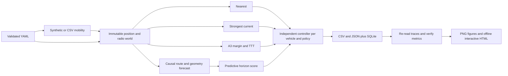

# Architecture and implementation guide

NexTower is a discrete-time research simulator. It tests tower-selection decisions under
known route geometry, using an explicit synthetic power model. It does not connect to a modem.



## Why these boundaries matter

`config.py` constructs frozen settings from strict YAML. Unknown keys fail rather than silently
ignoring a spelling or unit error. `models.py` defines immutable positions, towers, rectangles,
links and events. Only a controller's `HandoverState` is mutable. No global policy state exists.

`mobility.py` interpolates piecewise-linear routes by traveled arc length. The car stops at the
last waypoint. `traces.py` exports/loads the same `PositionSample` schema, so the radio engine
does not need to know where positions originated. External traces must be sorted and contiguous
from zero for each vehicle. Leaving permanently is allowed; re-entry/internal gaps are rejected.

`geometry.py` clips a closed segment against axis-aligned slabs. Contact with a corner, edge,
endpoint or rectangle interior blocks the line. A zero-length segment is handled explicitly.
`channel.py` clamps distance to a nonzero reference distance, applies log-distance loss and a
single blockage penalty, then optionally adds a keyed Gaussian sample. The hash includes seed,
time, vehicle and tower; call order has no effect on the draw.

`engine.prepare_world` calculates actual mobility/radio observations once. All four policy
runs receive the same frozen `World`. `engine.simulate` creates a new controller per vehicle;
policy evaluation cannot mutate frozen position/link records. The method returns rows and events.

## Causal forecasting

The predictor receives the current observation, measured speed, known planned route, static
tower positions, channel assumptions, and a sanitized view of currently active rectangles.
The engine strips activation/expiration times from this view. Active rectangles persist in the
forecast; future appearances and disappearances are unknown. Future shadowing is zero-mean,
never the actual future draw. Forecasts are stored separately in the decision context.

The current position is projected onto the nearest planned-route segment; projected arc length
advances by current speed times forecast offset. Ties prefer earlier route progress. This works
for the supplied non-self-intersecting routes. Looping routes require a progress/history-aware
map matcher. Forecast location-error experiments add a deterministic, isotropic Gaussian offset
to forecast positions only, sampled once per decision; true observations stay unchanged.

The predictor has no realized future radio input. This is tested by changing future blocker
schedules and forecast channel-noise settings while keeping the present information fixed.

## Policies

All ties use tower ID ascending. Disabled towers are absent from current link observations.

* `nearest`: shortest current geometric distance, ignoring blockage. An unusable target is
  rejected by the controller and logged separately.
* `strongest`: highest current power proxy. Controller dwell and delay still apply.
* `a3`: a neighbor must exceed serving quality by strictly more than `a3_margin_db` for `ttt_s`.
  The candidate timer resets if the advantage disappears or the candidate changes.
* `predictive`: mean clamped forecast quality normalized to [0,1], minus forecast outage fraction
  and a switching penalty. A change requires a strictly positive configured score margin,
  current target usability, TTT, dwell, and controller feasibility checks.

For tower j the predictive score is:

```text
quality = mean(clamp(forecast_dbm, q_min_dbm, q_max_dbm))
normalized = (quality - q_min_dbm) / (q_max_dbm - q_min_dbm)
outage = mean(forecast_dbm < min_rx_dbm)
score[j] = weight_quality*normalized - weight_outage*outage
           - weight_switch*(j != serving)
```

The score is a research heuristic, not an optimal-control solution or trained AI model.

## State and observation ordering

At each timestamp: obtain immutable observations; complete a due pending switch; handle
loss of all usable cells or initial/recovery access; obtain a policy decision when attached;
request a valid switch; record the state and all current links.

```text
DISCONNECTED -> ATTACHED: common strongest-usable initial/recovery access
ATTACHED -> SWITCHING: usable other target, dwell satisfied
SWITCHING -> ATTACHED(new): delay elapsed and target usable
SWITCHING -> ATTACHED(old): failed target, original cell still usable
SWITCHING -> DISCONNECTED: failed target and original unusable
ATTACHED -> DISCONNECTED: no usable tower remains
```

A logical association can remain ATTACHED to an unusable serving link while another cell is
usable; this is an outage observation until a policy successfully switches. This preserves
reactive versus proactive timing differences. Loss of every usable cell clears association;
later recovery access is reported as `attached`, never mislabeled as a completed handover.
Initial/recovery access has no modeled delay; all policies share this simplifying assumption.

Switch delay is rounded up by observing completion at the first tick at/after its deadline.
The request tick counts as interrupted; the completion tick does not on success. A zero-delay
switch completes immediately. A pending request at the observation-window boundary is logged
as `incomplete`; no unobserved success is fabricated. Departing trace vehicles cancel pending
requests as failed. A3/predictive TTT starts at the first qualifying observation and requires
elapsed seconds, so TTT=1 with dt=0.5 at t=0 first becomes eligible at t=1, not t=0.5.

## Data and performance

`storage.py` writes CSV, config snapshots, metrics and manifests; metrics are calculated from
the just-saved CSV. The same parsed traces feed reporting. SQLite stores identical run IDs,
observations, radio links and events within transactions. `reporting.collect` checks both the
config hash and recomputed metrics before generating a report. Reported runs include download
copies, so the dashboard works offline by opening its HTML file directly.

For V vehicles, G towers, B blockers, N ticks and K forecast offsets, baseline work is
O(NVGB), proactive work O(NVGBK), and the stored world O(NVG). This deliberately favors clarity
over a spatial index. Benchmarks cache repeated (config hash, policy) outcomes. Parallel agents,
remote services, paid APIs, secret keys and external servers are unnecessary.
